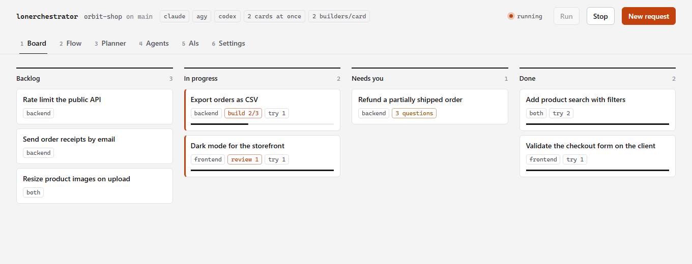
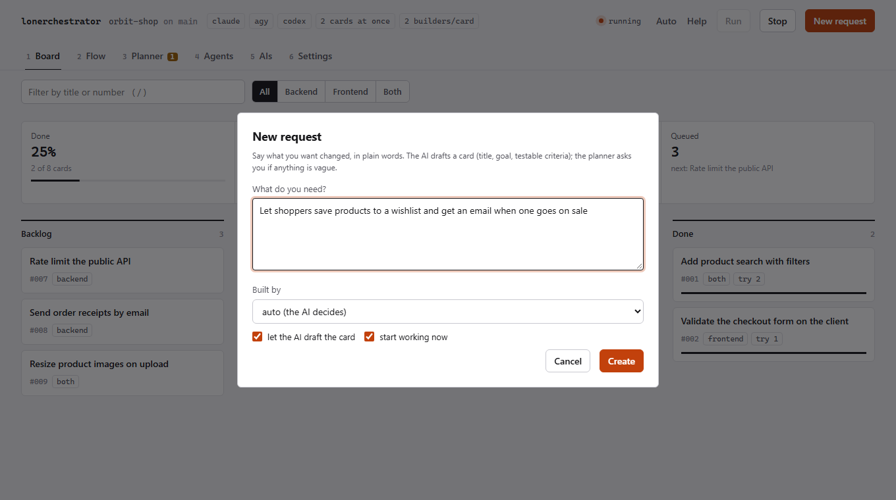
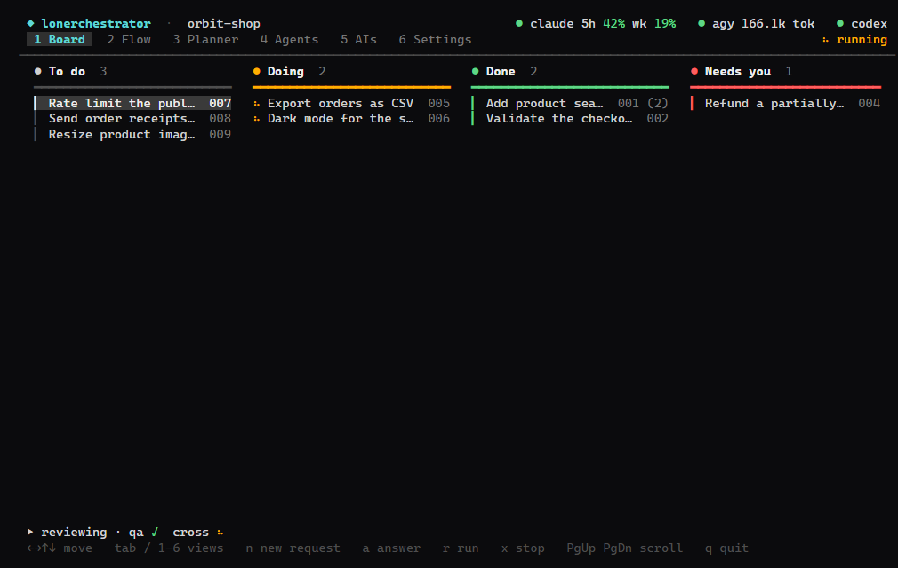
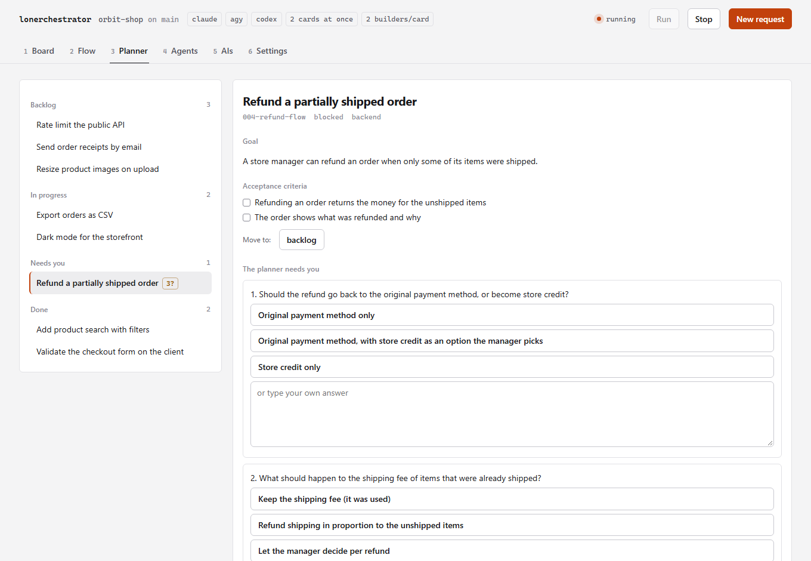
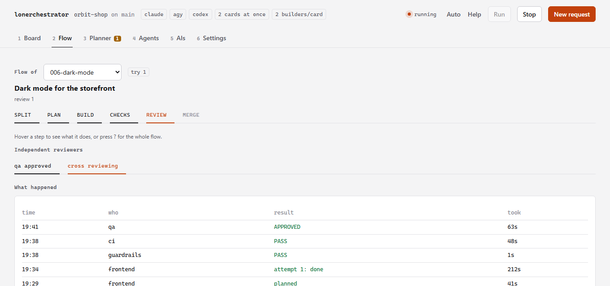
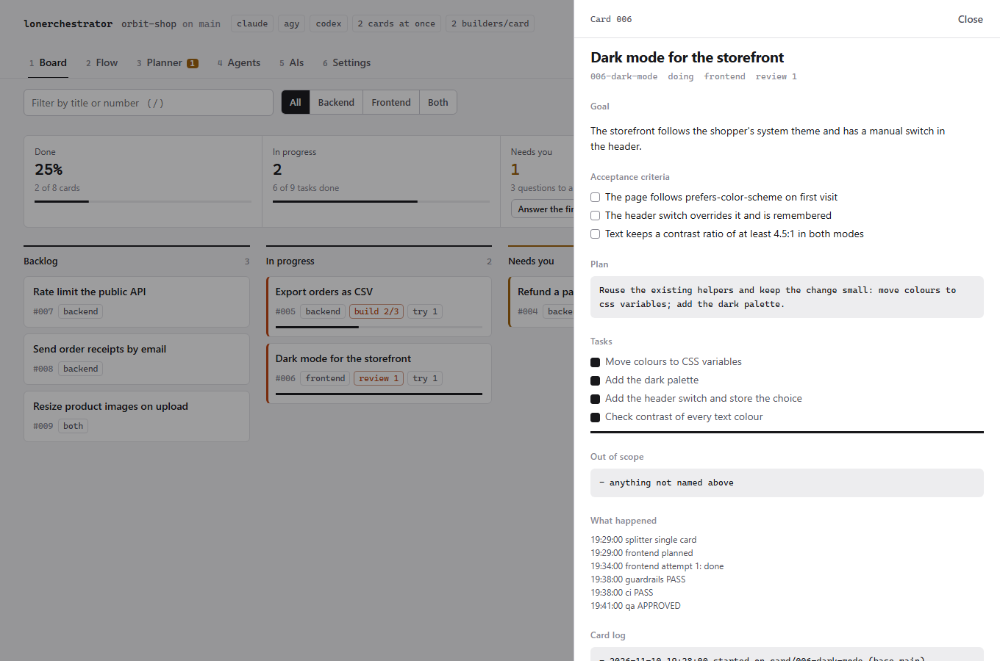
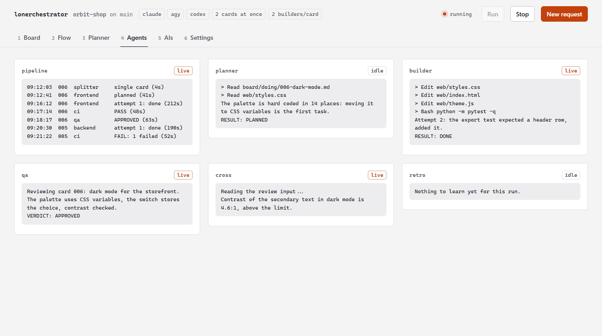
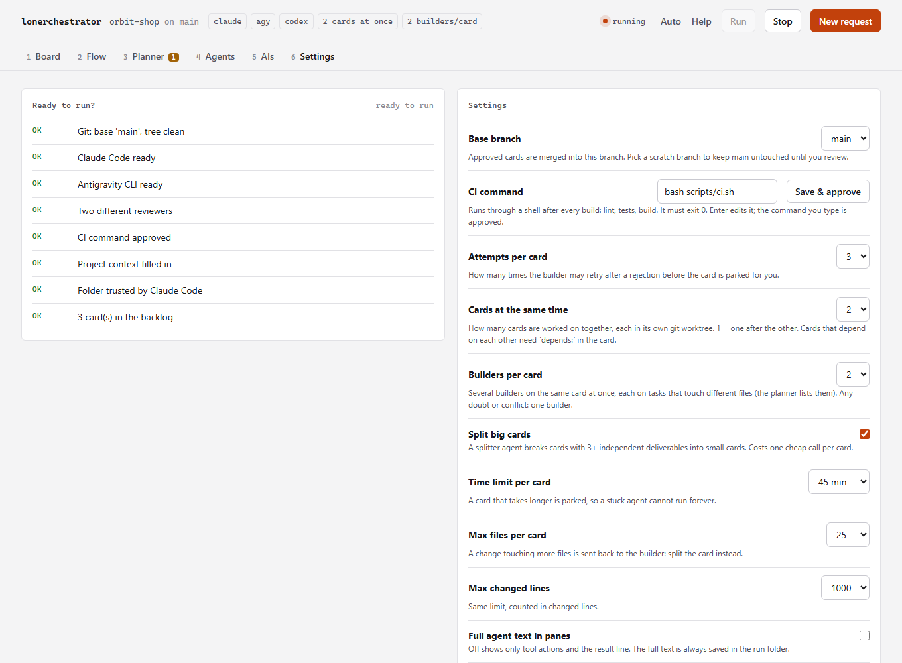
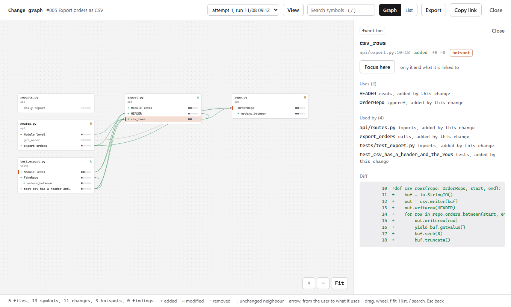
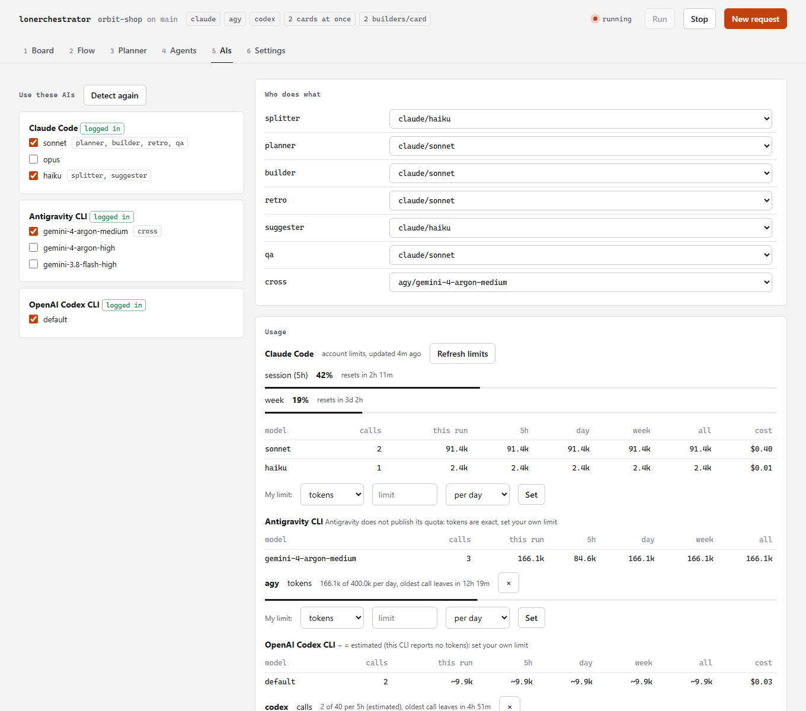

# lonerchestrator

[Português](README.pt-BR.md)

A **local multi-agent orchestrator** for AI coding agents. You write small *cards* describing what you want; agents plan, implement, review and fix them on their own, and only stop when a card is approved or needs a human.

It runs entirely on your machine, on the AI subscriptions you are already logged in to (**Claude Code** by default; Antigravity, Codex, Gemini CLI, Ollama or any CLI you describe also work). No API keys, no hosted service, no GitHub Actions, no server.

<p align="center">
<picture>
  <source media="(prefers-color-scheme: dark)" srcset="docs/images/board-dark.png">
  
</picture>
<br><sub>The board in your browser (<code>lonerchestrator web</code>): two cards being worked on at once, one waiting for your answers.</sub>
</p>

```
 card ─▶ SPLIT ─▶ PLAN ─▶ BUILD ─▶ CHECKS ─▶ REVIEW ─▶ MERGE
          │         │        │         │         │         │
      splitter   planner  builder  rules + CI  qa + cross  git + retro
```

| Stage | Who | What happens |
|---|---|---|
| SPLIT | `splitter` agent | Keeps the card whole, or breaks a big one (3+ independent deliverables) into small child cards |
| PLAN | `planner` agent | Writes a plan and a task checklist. If the card is vague it **stops and asks**, it never guesses |
| BUILD | `builder` agent | Implements the tasks and writes the tests |
| CHECKS | code, not prompts | Guardrails (protected files, diff size, secrets, deleted tests) + your `scripts/ci.sh` |
| REVIEW | `qa` + `cross` | Two independent reviewers, ideally on **different models**, in parallel. Both must approve |
| MERGE | git + `retro` agent | Commit, merge into the base branch, record lessons learned |

Core rules: **whoever builds never reviews** (reviewers only see the card, the diff and the test output, never the builder's reasoning); **3 attempts** per card, then it goes to `NEEDS YOU`; it **never deploys**.

> ⚠️ **Read [SECURITY.md](SECURITY.md) first.** The agents edit files and run commands on your machine. Guardrails and a deny-list reduce the risk; they do not remove it. Use it on projects under version control, with a clean working tree.

## Requirements

The full list, with how to check and install each item, is in [`requirements/`](requirements/README.md). `lonerchestrator doctor` checks it for you, and `lonerchestrator ais` shows which AI CLIs you have and installs the missing ones (it asks first).

| | |
|---|---|
| Python | 3.10+ (standard library only, no dependencies). With uv you do not even need to install it |
| git | any recent version |
| [Claude Code](https://claude.com/claude-code) | installed **and logged in** (`claude`). The default and best-tested AI. Any other AI that can edit files can replace it (see [Any AI](#any-ai)) |
| [Antigravity CLI](https://antigravity.google) `agy` | optional. Gives the `cross` reviewer a Gemini model (a different model family catches different mistakes). Without it, `cross` is a second Claude model |
| bash | to run your project's `scripts/ci.sh` (Git Bash on Windows) |

You need your own Claude Code subscription/login. Usage counts against its limits; the orchestrator waits and retries on rate limits.

### Platforms

| | Panel (`tui`) | New window (`live`) | Notes |
|---|---|---|---|
| Windows 10/11 | ✅ used daily | ✅ Windows Terminal (`wt`) | reference platform |
| macOS | ✅ implemented, CI-tested | ⚠️ Terminal.app via `osascript`, best effort | the panel resizes itself with the xterm resize sequence |
| Linux | ✅ implemented, CI-tested | ⚠️ gnome-terminal, xfce4-terminal, kitty, alacritty, konsole, xterm | needs a graphical session; over SSH use `tui` |

`lonerchestrator tui` works in any terminal of at least **120×34**. Bug reports from macOS/Linux users are very welcome.

## Install

One line, no clone needed. The installer uses [uv](https://docs.astral.sh/uv/) if you have it (uv can even fetch Python for you), otherwise pipx, otherwise `pip --user`. It never needs admin rights and installs nothing but this tool.

**Windows (PowerShell)**

```powershell
irm https://raw.githubusercontent.com/FernandoDevBrito/lonerchestrator/main/install.ps1 | iex
```

**macOS / Linux**

```bash
curl -fsSL https://raw.githubusercontent.com/FernandoDevBrito/lonerchestrator/main/install.sh | bash
```

Open a **new terminal** and check everything:

```bash
lonerchestrator doctor
```

`doctor` lists what is installed (git, Claude Code, ...), what is missing and exactly how to fix it. Inside a project it also runs the "Ready to run?" checks.

### Other ways

**Install the AI CLIs together:** at the end the installer shows which AIs you have (Claude Code, Antigravity) and offers to install the missing ones, showing each official command first. Add `-With claude,agy` (PowerShell) or `--with claude,agy` (bash) to install them without being asked, or run `lonerchestrator ais` any time.

| You want to | Do this |
|---|---|
| Use uv or pipx directly | `uv tool install git+https://github.com/FernandoDevBrito/lonerchestrator` or `pipx install git+https://github.com/FernandoDevBrito/lonerchestrator` |
| Pin a version | `$env:LONERCHESTRATOR_REF="v0.1.0"` before the PowerShell line, or `curl ... \| bash -s -- --ref v0.1.0` |
| Look before installing | Save the script and run it with `-DryRun` / `--dry-run`: it prints every command and changes nothing |
| Update | Run the same line again, or `uv tool upgrade lonerchestrator` / `pipx upgrade lonerchestrator` |
| Uninstall | `install.ps1 -Uninstall` / `install.sh --uninstall` (your projects, cards and memory are never touched) |
| Hack on it | Clone, then `.\install.ps1 -Dev` / `./install.sh --dev`: an editable install, so `git pull` updates the command |

> Piping a script into your shell means trusting it. Both installers are short and live in this repository: read them first, or use `-DryRun`. Not published on PyPI yet.

## Quick start

```bash
cd your-project            # a git repository, clean working tree
claude                     # once: accept the folder trust dialog, then exit
lonerchestrator init       # installs board, agents, guardrails, context/ and runs the introduction
```

1. **Introduction** (`init`, or `lonerchestrator intro` any time): detects which AIs you are logged in to and lets you choose the model for each role, the two reviewers, and which agent handles each area.
2. `context/project.md` (stack, how to run tests, conventions) fills itself: when it is empty, the first `lonerchestrator run` has the AI study your repository and write it (or run `lonerchestrator context` any time). Read it and correct anything wrong. Adapt `scripts/ci.sh` to your project.
3. Open the panel and press `n`: write what you want changed in plain words, press `Enter`, and the card is created and the pipeline starts working on it (a vague request becomes questions for you, not guesses). `Tab` in that box picks the agent (backend, frontend, both). Prefer writing the card yourself? `lonerchestrator new "Add login"`, then edit it in `board/backlog/` with a goal and **testable** acceptance criteria.
4. `lonerchestrator` opens the panel. Press `r` to run.

<p align="center">
<picture>
  <source media="(prefers-color-scheme: dark)" srcset="docs/images/new-request-dark.png">
  
</picture>
<br><sub>Say what you want in plain words. The AI drafts the card, the pipeline starts, and a vague request becomes questions instead of guesses.</sub>
</p>

## The panel

<p align="center">

<br><sub>The same board in the terminal panel (<code>lonerchestrator</code>), 120x34, driven by the keyboard.</sub>
</p>

Run `lonerchestrator` (no arguments) to open a window at exactly **120×34** with six tabs:

| Tab | Shows |
|---|---|
| **1 Board** | TO DO / DOING / DONE / NEEDS YOU columns with your cards |
| **2 Flow** | The pipeline as connected nodes, with sub-nodes (model, memory, agent, rules) and the latest events |
| **3 Planner** | The selected card: goal, criteria, plan, tasks (`[ ]`/`[x]`), questions for you, history |
| **4 Agents** | What each agent is doing right now, in six aligned live panes |
| **5 AIs** | A checklist of the AIs/models you allow, who does what, and your **live usage** (see below) |
| **6 Settings** | Your project's options and a **"Ready to run?"** check that tells you what is still missing and how to fix it |

Keys: `←→↑↓` move/select · `1`–`6` or `Tab` switch tab · `n` **new request** · `a` answer a blocked card · `PgUp`/`PgDn` scroll · `r` run the pipeline · `x` stop · `q` quit.

### The Settings tab: configure without editing JSON

- **Settings** (left): base branch, CI command, attempts per card, split big cards, time limit, max files and changed lines per card, full agent text, and running your own git hooks. `↑↓` move, `←/→` or `space` change a value, `Enter` edits the CI command. Each change is saved to `.orchestrator/config.json` at once, and the line under the list explains the selected option. The CI command you type here is approved automatically (you wrote it).
- **Ready to run?** (right): Git and the base branch, Claude Code installed and logged in, the two reviewers, the CI command (script exists, approved), `context/project.md` filled in, Claude Code trusting the folder, and cards in the backlog. Anything missing shows the exact fix. Open this tab first in a new project.

### The AIs tab: choose your AIs, watch your usage

- **AIs to use**: every model of the AIs you are logged in to, as a checklist (`↑↓` move, `space` check/uncheck). Unchecking a model that a role uses moves that role to another checked model; you cannot uncheck the last Claude model. Changes are saved to `.orchestrator/config.json` immediately.
- **Who does what**: `splitter`, `planner`, `builder`, `retro` (Claude models) and the two reviewers `qa`/`cross` (any checked AI). `←/→` or `space` changes the model. It warns when both reviewers use the same model.
- **Usage, live**, the same way for every AI:
  - **Claude Code**: your account's **5-hour session** and **weekly** limits as bars with the reset time (the same numbers as `/usage`), plus tokens per model. They update after every agent call; press `u` to refresh on demand (one tiny haiku call).
  - **Every other AI** (Antigravity, Codex, Gemini, Ollama, your own): calls and tokens per model, this run and all runs, and over rolling windows (5 hours, day, week in the web page). Tokens are **exact** when the CLI reports them (Antigravity does; any CLI can be taught with `usage` in its provider, see below) and **estimated** otherwise (about 4 characters per token), always marked with `~`.
  - **Your own limits**: most CLIs do not publish their quota, so you set it. `"budgets": {"agy": {"tokens": 5000000, "per": "day"}, "codex": {"calls": 200, "cost": 20, "per": "5h"}}` (a key is an AI or `ai/model`; units `tokens`, `calls`, `cost` in USD; periods `5h`, `day`, `week`, `month`, rolling). Each shows as a bar with when the oldest call stops counting. The web page's AIs tab has a form for it.
  - **Cost**: give a provider a `price` (`{"in": 3.0, "out": 15.0}`, USD per million tokens) and its tokens become an estimated cost.
  - The header always shows the compact version, e.g. `claude ● 5h 52% wk 19%   agy ● 18.0k tok`.
- `d` re-detects which AIs you are logged in to. An AI that is not ready shows how to fix it (install or log in).

## Commands

| Command | Does |
|---|---|
| `lonerchestrator` | Open the panel for the project in the current folder (same as `live`) |
| `init [--force]` | Set up a project (never overwrites existing files without `--force`) |
| `intro [--yes]` | Detect logged-in AIs and assign models/agents (`--yes` accepts the defaults) |
| `new "title" [--area frontend\|backend\|both\|docs\|<yours>]` | Create a numbered card in `board/backlog/` |
| `answer [card]` | Answer a blocked card's questions in the terminal and send it back to the backlog |
| `trust [--yes]` | Approve the project's CI command (it runs through a shell). Asked once, the first time you open or run a project |
| `run [--card id] [--base branch] [--dry-run]` | Process the backlog headless |
| `live` / `tui` `[--tab 1-5]` | Panel in a new window of the right size / in the current terminal, optionally opened on a tab |
| `tail <role>` | Follow one agent's output (`planner`, `builder`, `qa`, `cross`, `retro`, `pipeline`) |
| `status` | Board counts and latest events |
| `graph <card> [--attempt N] [--compare A..B] [--focus NAME] [--format tree\|ascii\|json\|mermaid\|dot\|svg] [--out FILE] [--tui]` | A card's [change graph](#change-graph): the symbols its diff changed and what uses them |
| `-C <dir>` | (before any command) target another project |

## When a card needs you

Vague cards ("make it faster", "a nice report") are **not implemented**. The agent stops and leaves numbered questions, and the card goes to **Needs you**. Cards that use all 3 attempts end up there too, with the partial work kept on the branch `card/<id>`.

<p align="center">
<picture>
  <source media="(prefers-color-scheme: dark)" srcset="docs/images/planner-dark.png">
  
</picture>
<br><sub>The planner asks instead of guessing. Pick one of the 3 suggested answers or write your own, then <em>Send answers &amp; run</em>.</sub>
</p>

**Answer inside the panel:** open the card in the **Planner** tab (or select it on the Board) and press `a`. The questions appear one at a time, each with **3 suggested answers**: press `1`, `2` or `3` to pick one (it moves straight to the next question), or type your own answer and press `Enter` (`Esc` cancels, an empty answer skips that question). Once you have typed something, digits are plain text. If a card's questions came without suggestions (an older card, or an agent that forgot), the panel asks Claude for them in the background when you press `a`: one small haiku call, read-only, and you can start typing meanwhile. After the last one the answers are saved in the card under `## Answers`, its questions are cleared, and the card goes back to the backlog. Press `r` to run it again; the planner reads your answers and does not ask the same thing twice.

**Without the panel:** `lonerchestrator answer 002` asks the same questions in the terminal (type 1-3 to pick a suggestion, or write your own) and does the same.

**By hand** still works: write the answers in the card's `## Answers` section and move the file from `board/blocked/` back to `board/backlog/`.

## Guardrails

Checked by **code**, not by prompts, before CI runs:

- protected paths cannot change (`scripts/**`, `.claude/**`, `CLAUDE.md`, `GEMINI.md`, `.orchestrator/**`)
- diff size limits per card (default 25 files / 1000 lines): too-big cards must be split
- deleted tests and secrets in the diff (keys, tokens, passwords) are rejected; a secret is reported as `path:line`, never copied into the card or the logs
- one branch per card (`card/<id>`); nothing merges without both reviewers approving and CI passing
- agents never commit, merge, push or switch branches: the orchestrator owns git
- rate limits: waits with backoff and resumes; an expired login aborts without losing the card
- the project's `.claude/settings.json` allows only what is needed and denies `rm -rf`, `git push`, `git reset --hard`, etc.

## Configuration

`.orchestrator/config.json` in your project (only what you want to change; the rest comes from defaults):

```json
{
  "base": "main",
  "ci": "bash scripts/ci.sh",
  "max_attempts": 3,
  "split": true,
  "verbose": false,
  "roles": { "planner": { "cli": "claude", "model": "sonnet" } },
  "reviewers": [
    { "name": "qa",    "kind": "claude", "agent": "qa", "model": "sonnet" },
    { "name": "cross", "kind": "agy",    "model": "<a model from `agy models`>" }
  ],
  "guardrails": { "max_files": 25, "max_diff_lines": 1000 }
}
```

`base` is the branch that receives approved cards. Point it at a scratch branch to keep `main` untouched until you decide.

### Effort, areas and the docs agent

- **Effort per role.** Any role or reviewer can say how hard its model thinks: `"builder": {"cli": "claude", "model": "opus", "effort": "xhigh"}`, or `"effort": "low"` on the splitter to save quota. The words are `low`, `medium`, `high`, `xhigh`, `max` (unset = the CLI's default). Claude Code gets `--effort`; Codex gets `model_reasoning_effort` (above `high` is lowered to `high`); a CLI with no way to take it ignores it. Your own provider takes it with `"effort_args": ["--effort", "{effort}"]` and, optionally, `"efforts"` (the words it accepts). The web page's AIs tab has an effort list next to every role.
- **Areas are yours.** The keys of `agents` are the areas a card may have, each mapped to an agent file: `"agents": {"data": "data-eng"}` adds a `data` area built by `.claude/agents/data-eng.md`. Other AIs get that file's text in their prompt, so any AI can play any agent. *Ready to run?* warns when an area's agent file is missing.
- **The `docs` area: documenter and researcher.** Cards about documentation (README, guides, docstrings, API docs, changelog) or a question to answer ("which library fits us?") go to the `docs` agent. It reads before it writes, backs every claim about the project with `path:line` or a command's output, runs every example it writes, never changes product behaviour, and writes research to `docs/research/<card>.md`: short answer first, evidence, options with trade-offs, a recommendation. A request with words like *document*, *README*, *guide* or *research* (and no code words) is filed under `docs` by itself.
- **Decisions leave a trail.** Every builder (backend, frontend, docs) records a non-obvious choice as one line in `context/decisions.md` (date, decision, why, card) and updates `context/project.md` when the stack or commands change, so the next agent does not repeat the debate.

## The kanban page (browser)

```bash
lonerchestrator web
```

Everything the terminal panel does, in your browser, served only to your own computer (`127.0.0.1`, with a random access token in the link it prints). Six tabs (keys `1`-`6`), updated by themselves while the pipeline runs:

<p align="center">
<picture>
  <source media="(prefers-color-scheme: dark)" srcset="docs/images/flow-dark.png">
  
</picture>
<br><sub>Flow: where a card is, and what each independent reviewer said.</sub>
</p>
<p align="center">
<picture>
  <source media="(prefers-color-scheme: dark)" srcset="docs/images/card-dark.png">
  
</picture>
<br><sub>Click a card: goal, criteria, plan, task progress and what each agent did.</sub>
</p>
<p align="center">
<picture>
  <source media="(prefers-color-scheme: dark)" srcset="docs/images/agents-dark.png">
  
</picture>
<br><sub>Agents: the live output of the planner, builder, reviewers and retro.</sub>
</p>
<p align="center">
<picture>
  <source media="(prefers-color-scheme: dark)" srcset="docs/images/settings-dark.png">
  
</picture>
<br><sub>Settings: "Ready to run?" with the exact fix for each item, and every option.</sub>
</p>

- **Board:** the kanban. **Drag a card to another column**: Backlog to *Needs you* holds it, *Needs you* or *Done* back to Backlog re-queues it (a finished card can be redone), and dropping a card between others in the Backlog sets its priority (`priority:` in the card header; lower runs first). Valid columns light up while you drag; a card being worked on cannot be moved, and only the pipeline moves cards into *In progress* and *Done*. Without a mouse (or on a phone) open the card and use *Move to*.
- **Flow:** the stages of a card (split, plan, build, checks, review, merge), the independent reviewers' verdicts and what happened, for the running card or any recent one.
- **Planner:** every card with its goal, criteria, plan, task progress and log. Questions come with 3 suggested answers (click one or type your own, then *Send answers & run*); *Suggest answers* asks the AI when a card came without.
- **Agents:** the live output of the pipeline, planner, builder, qa, cross and retro.
- **AIs:** which AI models are on, who does what (splitter, planner, builder, retro, suggester, qa, cross), live Claude account limits (session and week, with reset time), tokens and calls per model for this run and all runs, *Detect again* and *Refresh limits*.
- **Settings:** "Ready to run?" with the exact fix for each item, and every setting (base branch, CI command, attempts, cards at once, builders per card, limits, ...). Saving the CI command approves it, like in the terminal.

**＋ New request** (any tab): say what you want changed in plain words. The AI with the `suggester` role drafts the card (title, which agent builds it, goal, 2 to 5 testable criteria); without a reachable AI a plain rule-based draft is used, so a request is never lost. Tick *start working now* and the pipeline starts (or picks the card up if it is already running). A vague request is fine: the planner asks you instead of guessing. **Run** and **Stop** are in the header.

Safety: the page only accepts requests that carry the token, come from `127.0.0.1`/`localhost` (DNS-rebinding check) and, for changes, from the page itself (Origin check). Everything the server sends is shown as text, never as HTML. Use `--port N` to pick a port and `--no-open` to only print the link.

## Change graph

Before you read a card's diff line by line, see what it touched: the functions, classes and files it changed, and the code that uses them or is used by them. Open a card and press **Change graph** (or `g`):

<p align="center">
<picture>
  <source media="(prefers-color-scheme: dark)" srcset="docs/images/graph-dark.png">
  
</picture>
<br><sub>Files are boxes, changed symbols are rows (<code>+</code> added, <code>~</code> modified, <code>-</code> removed, <code>.</code> an unchanged neighbour), edges run from the user to what it uses. Hotspots, the most connected changes, are marked: start there.</sub>
</p>

- **Click a symbol** for where it is, what it uses, what uses it, what the reviewers and the guardrails said about it, and its own lines of the diff. **Focus here** keeps it and its neighbours.
- **View** filters by status, tests, reviewer findings and guardrail hits; search with `/`; **List** shows the same thing as text; **Export** saves SVG, Mermaid (paste it in a pull request), DOT or JSON. Drag to pan, wheel or `+` `-` to zoom, `f` to fit. The address bar is always a link to this exact view (`?graph=<card>`).
- **Attempts:** every attempt saves its graph, so you can open an earlier one or compare two and see what the fix loop changed.
- **In the terminal:** `lonerchestrator graph 005` prints the same as a tree; `--focus <name>` one symbol's neighbourhood, `--compare 1..2` two attempts, `--format mermaid|dot|svg|json --out FILE` a file, `--tui` browses it with the keyboard.

It only shows: it never approves or blocks a card, reads git without running your code, and never shows a secret or the content of a protected file. Reviewers can also get a short summary of it computed from the diff (*Reviewers read the graph* in Settings, off by default). How it is built, the JSON schema and how to add a language: [docs/change-graph.md](docs/change-graph.md).

## Several cards at once

Set **Cards at the same time** in the Settings tab (or `"parallel": 3` in the config, or `lonerchestrator run -j 3`). Each card then works in its own git worktree under `.orchestrator/worktrees/<card>` with its own branch, so agents never touch each other's files. Planning, building, guardrails, CI and the two reviews run in parallel; merges and retros happen one at a time in your main checkout. If another card was merged first, a card merges the new base into its branch and runs CI again before it is merged.

- **Dependencies:** a card that needs another one first says so in its header, `depends: 001-schema, 002-api`. It waits until those are in `done/`. Cards without `depends` are assumed independent.
- **Fresh worktrees have no installed dependencies** (`node_modules`, a virtualenv, ...). Put the command that prepares one in `"setup"` (for example `"npm ci"`); it runs once per card, and is part of what `lonerchestrator trust` approves.
- Each running card uses its own agent calls, so it uses your AI limits faster. Rate limits are still waited out per card.
- The panel's Flow tab follows the most recently active card; the Board tab marks every running card. The agent panes interleave the output of all running cards (each line of the log table names its card).
- `parallel: 1` (the default) is the old behaviour: one card after the other, no worktrees.

## Several builders on one card

Set **Builders per card** (Settings tab, or `"builders": 3`) and the planner lists the files each task changes: `- [ ] add the endpoint [files: api/users.py, tests/test_users.py] (criterion 1)`. Tasks that share no file are built **at the same time**, each group by its own builder in a throw-away worktree; the parts are then merged into the card branch, and guardrails, CI and the two reviews run on the whole result as usual.

It falls back to ONE builder, with nothing kept from the attempt, whenever anything is doubtful: a task without `[files: ...]`, all tasks sharing a file, a part that touches a file it did not declare, a blocked part, or a merge conflict. Only the first attempt is built by the team; retries after a rejection use one builder. It combines with parallel cards. Projects created before this feature keep their old planner instructions: run `lonerchestrator init --force` to refresh them (it overwrites the template files, agents and `CLAUDE.md` included, so commit your edits first), or add the `[files: ...]` rule to your planner agents by hand.

## Any AI

Every role (splitter, planner, builder, retro, the two reviewers and the answer suggester) can run on **any AI command-line tool**, not only Claude Code. Pick them in the AIs tab, or in `.orchestrator/config.json`:

<p align="center">
<picture>
  <source media="(prefers-color-scheme: dark)" srcset="docs/images/ais-dark.png">
  
</picture>
<br><sub>Any AI in any role, with live usage: Claude's account limits, exact tokens when a CLI reports them, estimates marked <code>~</code>, and your own budgets.</sub>
</p>

```json
{
  "roles": { "builder": { "cli": "codex", "model": "default" }, "suggester": { "cli": "ollama", "model": "llama3" } },
  "reviewers": [ { "name": "qa", "kind": "gemini", "model": "default" }, { "name": "cross", "kind": "mine" } ],
  "providers": {
    "mine": {
      "name": "My AI",
      "cmd": ["my-ai", "run"],
      "model_args": ["--model", "{model}"],
      "edit_args": ["--allow-edits"],
      "read_args": ["--read-only"],
      "prompt_via": "stdin",
      "models": ["big", "small"]
    }
  }
}
```

A provider is just *how to call the CLI* (its tokens can be read from what it prints, so usage is exact instead of estimated: `"usage": {"in_regex": "input: (\\d+)", "out_regex": "output: (\\d+)"}`, or `{"total_regex": ...}`, or `{"json": {"in": "usage.input", "out": "usage.output"}}`; `strip_after` cuts a statistics block out of the answer): `cmd`, `model_args` (`{model}` is replaced; the model `default` passes none), `edit_args` (added for roles that change files) and `read_args` (added for reviewers and suggestions), and `prompt_via` (`arg`, the default, with an optional `prompt_flag` such as `-p`; or `stdin`). Set `"can_edit": false` for text-only models: they can review and suggest but not build. Anything that takes a prompt and prints an answer works.

| AI | How it is known | Status |
|---|---|---|
| Claude Code | native preset | tested by the author |
| Antigravity (`agy`) | preset | tested by the author |
| OpenAI Codex (`codex exec`) | preset | **written from the vendor docs, not run here**: check `codex exec --help` |
| Gemini CLI (`gemini`) | preset | **written from the vendor docs, not run here**: check `gemini --help` |
| Ollama (`ollama run`) | preset, text only | **written from the vendor docs, not run here** |
| OpenCode, Aider, Goose, your own script... | define it under `providers` | flags differ per version: check the tool's `--help` |

You can change a preset the same way (an entry named `codex` in `providers` overrides its flags). Other AIs get the same instructions as the Claude agents (`.claude/agents/<role>.md` plus `CLAUDE.md`, put in the prompt) and the reviewers get the diff written into the prompt, so they work even if the CLI cannot read files.

What stays the same for every AI: the guardrails on the diff (protected paths, size, secrets, deleted tests), the check that an AI did not touch `.git`, the CI command, the two independent reviewers and the human gates. What is different: `.claude/settings.json` (its allow/deny lists) only restricts Claude Code. For every other AI the limits are the flags in its provider (`edit_args`/`read_args`, e.g. a sandbox mode), so read them. Because a provider starts a program, a provider defined in a project's config must be approved once with `lonerchestrator trust`, like the CI command.

## The agents study your project

Agents read `context/project.md` before every card. When it is empty, the orchestrator studies the repository and fills it in, so the agents are not blind:

- **When:** at the start of `lonerchestrator run` (the panel's and the web page's Run included) when there are cards to do, with `lonerchestrator context`, or with the *Study the project now* button in the web page's Settings tab.
- **What it looks at, without any AI:** file tree and languages, `package.json` / `pyproject.toml` / `Cargo.toml` / `go.mod` / `Makefile` (scripts and targets become the test, lint and build commands, all of them in a mixed repo), tooling configs, CI workflows, test folders, the start of the README and the last commits. Secrets (`.env`, keys) are never read.
- **Who writes it:** the AI with the `suggester` role gets only those facts (read-only, no tools) and writes the five bullets: what it is, stack, how to run/test/lint/build, conventions, what agents must never do. It is told to write `unknown: ask the user` instead of inventing. With no AI available, the facts are written as they are, so the file is never empty and a run never waits for an AI.
- **Yours stays yours:** a file that already has content is never overwritten (`--force` drafts it again; `--basic` skips the AI). The new file is committed when your working tree was clean, so the run can go on; otherwise it is left for you to commit.
- The facts (file names, manifest scripts, README start) go to the same AI you already use for the `suggester` role, nothing else leaves your machine.

## What each project gets

```
your-project/
├── CLAUDE.md  GEMINI.md          orchestrator and reviewer rules
├── board/{backlog,doing,review,done,blocked}/   cards (.md); local, gitignored
├── context/{project,decisions,history}.md       context the agents read
├── memory/{backend,frontend,docs,qa}.md         lessons learned per area (the retro agent maintains it)
├── .claude/{agents,skills,settings.json}        agents and permissions
├── scripts/ci.sh                                your lint + tests + build
└── .orchestrator/                               config, per-run logs, live streams
```

Logs: `board/_log.md` (readable table), `.orchestrator/runs/<run>/events.jsonl` (structured) and, per card, the full text of every agent.

## Troubleshooting

| Symptom | Fix |
|---|---|
| `Failed to authenticate` / OAuth expired | Run `claude` (or `agy`) once and log in |
| Permissions in `settings.json` ignored | Folder not trusted: run `claude` inside it and accept the dialog (trusting the parent folder is not enough) |
| "working tree not clean" | Commit or stash first; the orchestrator requires a clean tree |
| "Window too small" | The panel needs 120×34: use `lonerchestrator live` or enlarge the window |
| `gemini` CLI asks you to migrate | Use `agy` (the Antigravity CLI) for Gemini models |
| Pipeline does not start from the panel | Look at `.orchestrator/run.out` |

## Development

```bash
python -m venv .venv && . .venv/bin/activate      # Windows: .venv\Scripts\activate
python -m pip install -e . -r requirements/dev.txt
ruff check . && pytest -q
```

Standard library only. Modules in `orch/`: `pipeline` (the loop), `agents` (CLI runner, backoff), `guardrails`, `board` (cards), `gitops`, `events` (logs), `tui`/`view` (panel), `term` (keyboard/process/window per OS), `intro`, `config`, `cli`. Templates copied by `init` live in `orch/templates/` (`dot-claude/` becomes `.claude/`). See [CONTRIBUTING.md](CONTRIBUTING.md).

## License

[MIT](LICENSE)
