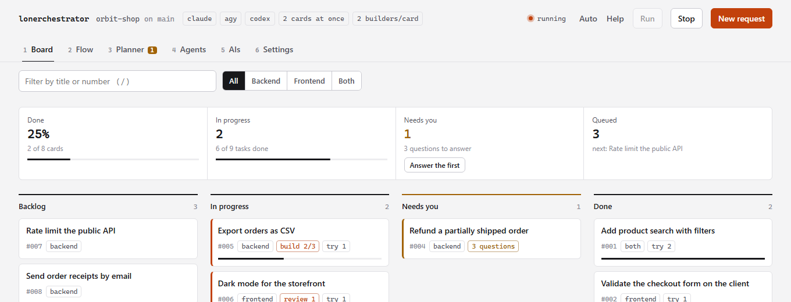
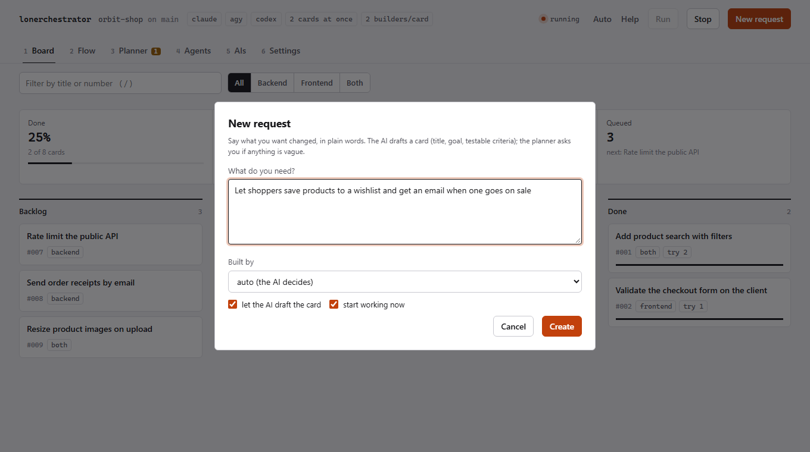
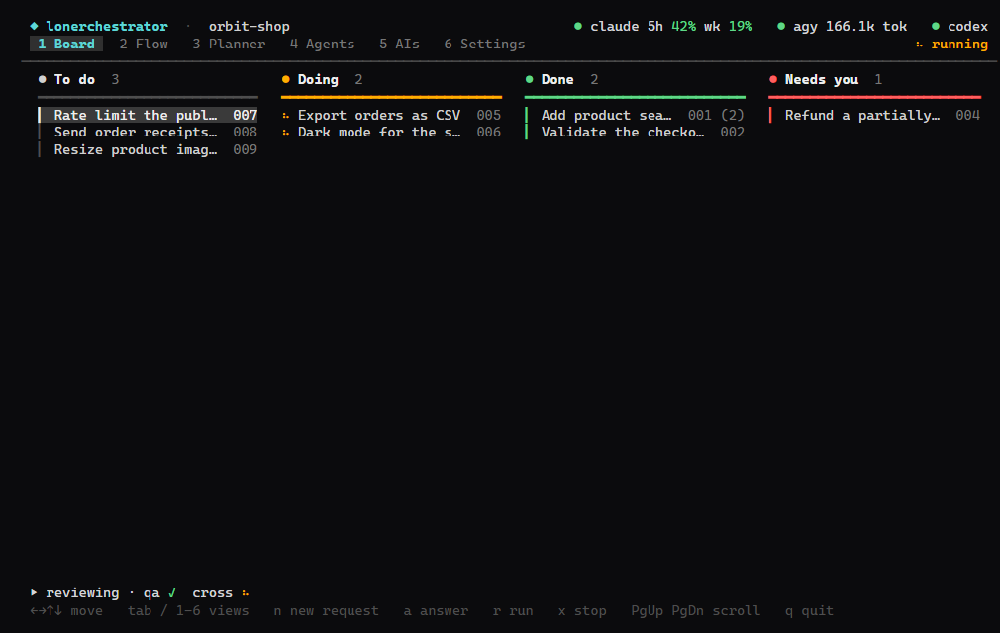
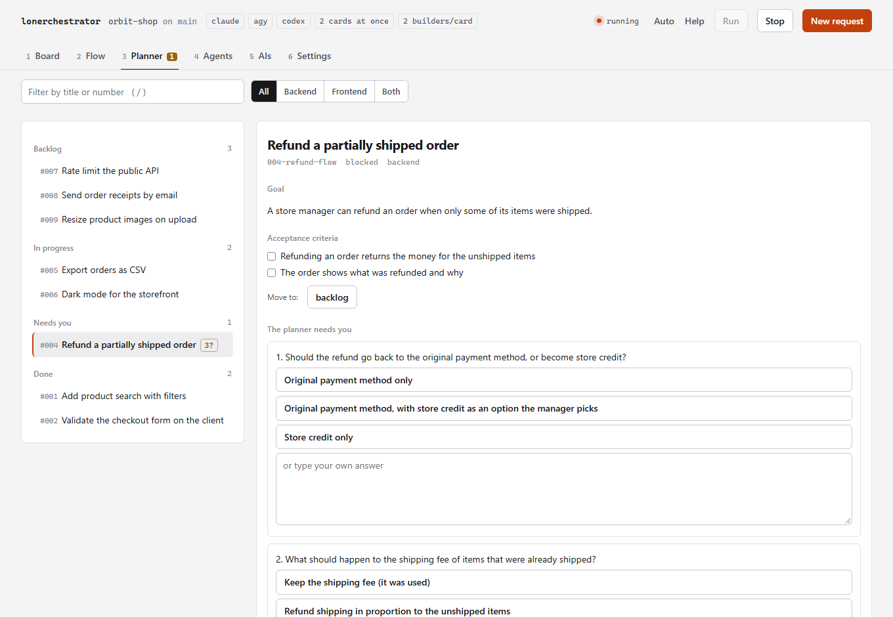
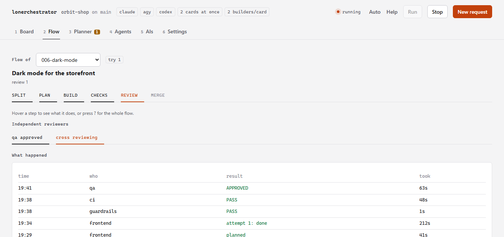
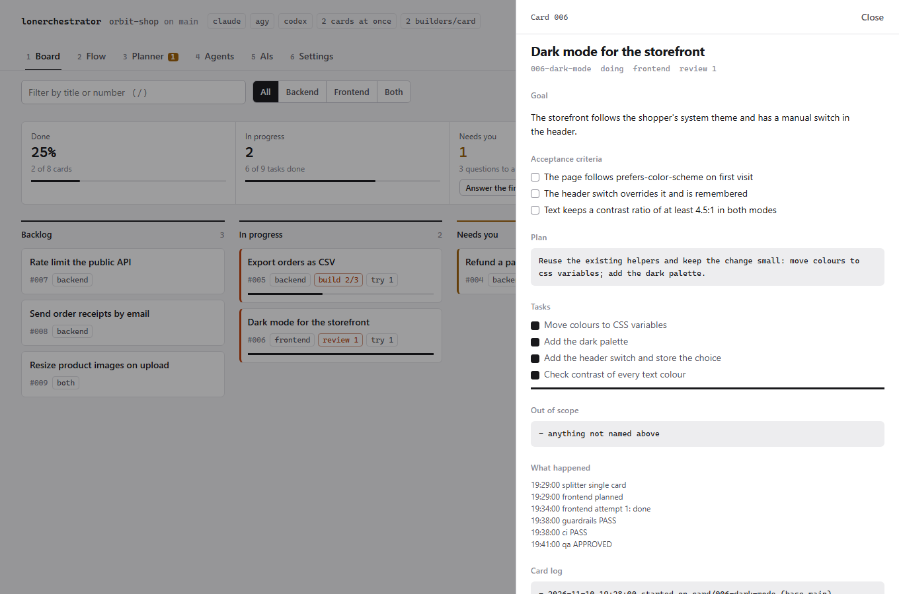
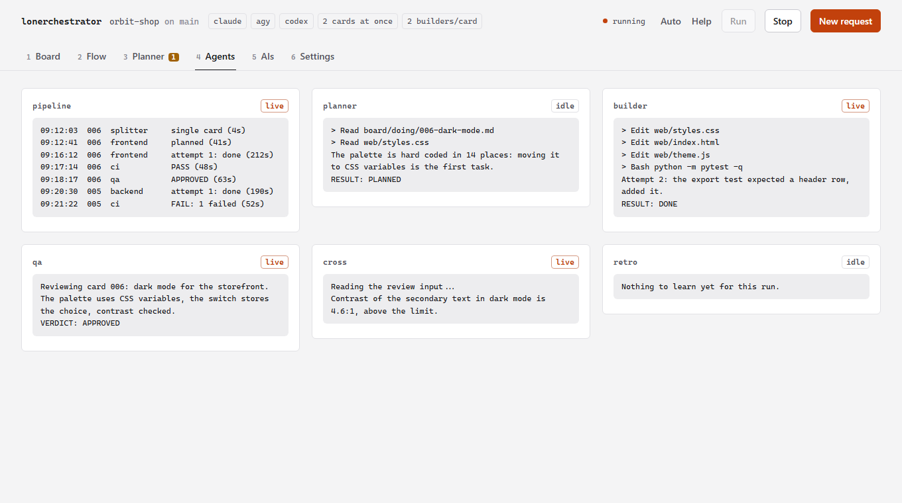
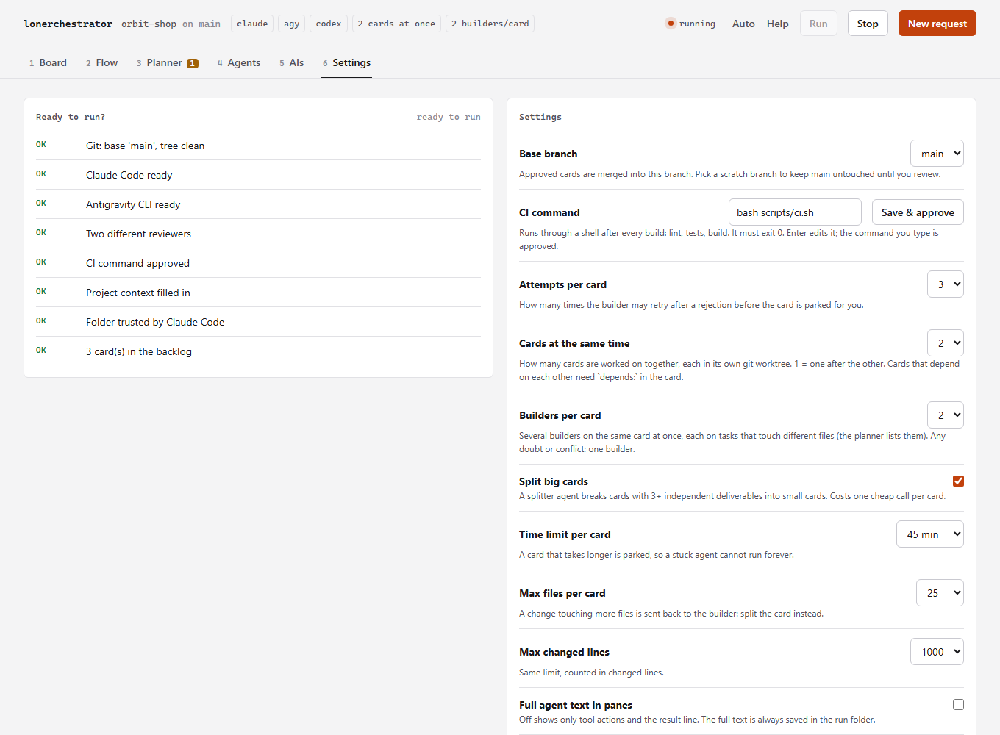
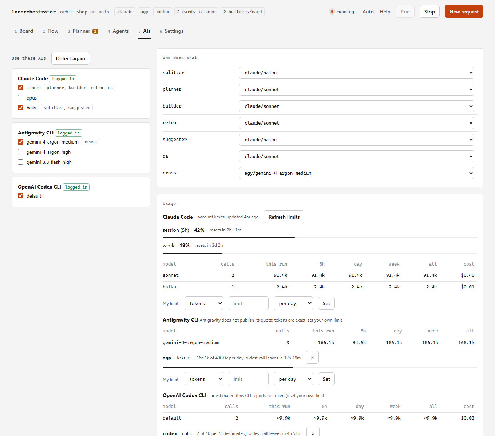

# lonerchestrator

[English](README.md)

Orquestrador local de agentes de IA. Você escreve **cards** de demanda; agentes planejam, implementam, revisam e corrigem sozinhos, e só param quando o card é aprovado ou precisa de você.

Roda 100% na sua máquina, usando as assinaturas que você já tem logadas (**Claude Code** por padrão; Antigravity, Codex, Gemini CLI, Ollama ou qualquer CLI que você descrever também servem). Sem chaves de API, sem GitHub Actions, sem servidor.

<p align="center">
<picture>
  <source media="(prefers-color-scheme: dark)" srcset="docs/images/board-dark.png">
  
</picture>
<br><sub>O board no navegador (<code>lonerchestrator web</code>): dois cards em andamento ao mesmo tempo, um esperando as suas respostas.</sub>
</p>

```
 card ─▶ SPLIT ─▶ PLAN ─▶ BUILD ─▶ CHECKS ─▶ REVIEW ─▶ MERGE
          │         │        │         │         │         │
      splitter   planner  builder  regras+CI   qa + cross   git + retro
```

| Etapa | Quem | O que faz |
|---|---|---|
| SPLIT | `splitter` | Mantém o card inteiro ou quebra um card grande em cards pequenos (3+ entregas independentes) |
| PLAN | `planner` | Escreve o plano e a lista de tarefas; se o card for vago, **para e pergunta** (nunca chuta) |
| BUILD | `builder` | Implementa as tarefas e escreve os testes |
| CHECKS | código | Guardrails (arquivos protegidos, tamanho, segredos, testes apagados) + `scripts/ci.sh` |
| REVIEW | `qa` + `cross` | Dois revisores independentes, **em modelos diferentes**, em paralelo. Os dois precisam aprovar |
| MERGE | git + `retro` | Commit, merge na branch base, `retro` registra as lições |

Regras de ouro: **quem faz nunca avalia** (os revisores só veem o card, o diff e a saída dos testes, nunca o raciocínio de quem implementou), **3 tentativas** por card e depois ele vai para `NEEDS YOU`, e **nunca faz deploy**.

## Requisitos

A lista completa, com como conferir e instalar cada item, está em [`requirements/`](requirements/README.md). O `lonerchestrator doctor` confere tudo, e o `lonerchestrator ais` mostra quais CLIs de IA você tem e instala as que faltam (pergunta antes).

- Python 3.10+ (só biblioteca padrão) e git
- [Claude Code](https://claude.com/claude-code) logado (`claude`). A IA padrão e a mais testada; qualquer outra IA que edite arquivos pode substituí-lo (veja [Qualquer IA](#qualquer-ia))
- [Antigravity CLI](https://antigravity.google) logado (`agy`), **opcional**: dá ao revisor `cross` um modelo Gemini (uma família de modelo diferente pega erros diferentes). Sem ele, o `cross` usa um segundo modelo Claude
- bash, para rodar o `scripts/ci.sh` do projeto (Git Bash no Windows)

Você precisa da sua própria assinatura/login do Claude Code; o uso conta nos limites dela (o orquestrador espera e tenta de novo quando bate o limite).

| Plataforma | Painel (`tui`) | Janela nova (`live`) |
|---|---|---|
| Windows 10/11 | ✅ uso diário | ✅ Windows Terminal (`wt`) |
| macOS | ✅ implementado, testado no CI | ⚠️ Terminal.app via `osascript`, melhor esforço |
| Linux | ✅ implementado, testado no CI | ⚠️ gnome-terminal, xfce4-terminal, kitty, alacritty, konsole, xterm (precisa de sessão gráfica) |

`lonerchestrator tui` funciona em qualquer terminal com pelo menos **120×34**.

> O `gemini` CLI antigo não funciona mais em contas individuais; o `agy` é o substituto.
> **Leia o [SECURITY.md](SECURITY.md) antes de usar:** os agentes editam arquivos e rodam comandos na sua máquina.

## Instalação

Uma linha, sem precisar clonar. O instalador usa o [uv](https://docs.astral.sh/uv/) se você tiver (o uv até baixa o Python para você), senão o pipx, senão `pip --user`. Ele nunca pede admin e não instala nada além desta ferramenta.

**Windows (PowerShell)**

```powershell
irm https://raw.githubusercontent.com/FernandoDevBrito/lonerchestrator/main/install.ps1 | iex
```

**macOS / Linux**

```bash
curl -fsSL https://raw.githubusercontent.com/FernandoDevBrito/lonerchestrator/main/install.sh | bash
```

Abra um **terminal novo** e confira tudo:

```bash
lonerchestrator doctor
```

O `doctor` lista o que está instalado (git, Claude Code, ...), o que falta e exatamente como resolver. Dentro de um projeto, também roda as checagens do "Ready to run?".

### Outras formas

**Instalar as CLIs de IA junto:** no fim o instalador mostra quais IAs você tem (Claude Code, Antigravity) e oferece instalar as que faltam, mostrando cada comando oficial antes. Use `-With claude,agy` (PowerShell) ou `--with claude,agy` (bash) para instalar sem perguntar, ou rode `lonerchestrator ais` quando quiser.

| Você quer | Faça |
|---|---|
| Usar uv ou pipx direto | `uv tool install git+https://github.com/FernandoDevBrito/lonerchestrator` ou `pipx install git+https://github.com/FernandoDevBrito/lonerchestrator` |
| Fixar uma versão | `$env:LONERCHESTRATOR_REF="v0.1.0"` antes da linha do PowerShell, ou `curl ... \| bash -s -- --ref v0.1.0` |
| Olhar antes de instalar | Salve o script e rode com `-DryRun` / `--dry-run`: mostra cada comando e não muda nada |
| Atualizar | Rode a mesma linha de novo, ou `uv tool upgrade lonerchestrator` / `pipx upgrade lonerchestrator` |
| Desinstalar | `install.ps1 -Uninstall` / `install.sh --uninstall` (seus projetos, cards e memória nunca são tocados) |
| Mexer no código | Clone e rode `.\install.ps1 -Dev` / `./install.sh --dev`: instalação editável, então `git pull` atualiza o comando |

> Passar um script direto para o shell é confiar nele. Os dois instaladores são curtos e estão neste repositório: leia antes, ou use `-DryRun`. Ainda não está publicado no PyPI.

## Começando em um projeto

```bash
cd D:\Github\meu_projeto
claude                       # uma vez: aceite o diálogo de confiança da pasta
lonerchestrator init         # instala board, agentes, guardrails, context/ e faz a introdução
```

1. **Introdução** (`init` ou `lonerchestrator intro`): detecta em quais IAs você está logado, deixa escolher o modelo de cada papel, os dois revisores e qual agente cuida de cada área.
2. O `context/project.md` (stack, como rodar testes, convenções) se preenche sozinho: quando está vazio, o primeiro `lonerchestrator run` faz a IA estudar o seu repositório e escrevê-lo (ou rode `lonerchestrator context` quando quiser). Leia e corrija o que estiver errado. Ajuste o `scripts/ci.sh` para o seu projeto.
3. Abra o painel e aperte `n`: escreva em palavras simples o que quer mudar, aperte `Enter`, e o card é criado e o pipeline começa a trabalhar nele (um pedido vago vira perguntas para você, não chute). `Tab` nessa caixa escolhe o agente (backend, frontend, both). Prefere escrever o card você mesmo? `lonerchestrator new "Adicionar login"`, e edite em `board/backlog/` com objetivo e critérios **testáveis**.
4. Abra o painel: `lonerchestrator`, e aperte `r`.

<p align="center">
<picture>
  <source media="(prefers-color-scheme: dark)" srcset="docs/images/new-request-dark.png">
  
</picture>
<br><sub>Diga o que quer em palavras simples. A IA monta o card, o pipeline começa, e um pedido vago vira perguntas em vez de chutes.</sub>
</p>

## O painel

<p align="center">

<br><sub>O mesmo board no painel do terminal (<code>lonerchestrator</code>), 120x34, controlado pelo teclado.</sub>
</p>

`lonerchestrator` (sem argumentos) abre uma janela do Windows Terminal já em **120×34**, com seis abas:

| Aba | Mostra |
|---|---|
| **1 Board** | Colunas TO DO / DOING / DONE / NEEDS YOU com os cards |
| **2 Flow** | O pipeline estilo n8n: nós, sub-nós (modelo, memória, agente, regras) e os últimos eventos |
| **3 Planner** | Card selecionado: objetivo, critérios, plano, tarefas (`[ ]`/`[x]`), perguntas pra você e histórico |
| **4 Agents** | O que cada agente está fazendo agora, em seis painéis alinhados |
| **5 AIs** | Checklist das IAs/modelos que você permite, quem faz o quê e o seu **uso em tempo real** (veja abaixo) |
| **6 Settings** | As opções do projeto e um **"Ready to run?"** que diz o que ainda falta e como resolver |

Teclas: `←→↑↓` mover/selecionar · `1`-`6` ou `Tab` trocar de aba · `a` responder um card bloqueado · `PgUp`/`PgDn` rolar · `r` rodar o pipeline · `x` parar · `q` sair.

Dentro de um terminal já aberto: `lonerchestrator tui` (precisa de pelo menos 120×34).

### A aba Settings: configure sem editar JSON

- **Settings** (esquerda): branch base, comando de CI, tentativas por card, quebrar cards grandes, limite de tempo, máximo de arquivos e de linhas por card, texto completo dos agentes e rodar seus próprios git hooks. `↑↓` move, `←/→` ou `espaço` muda o valor, `Enter` edita o comando de CI. Cada mudança é salva na hora em `.orchestrator/config.json`, e a linha embaixo da lista explica a opção selecionada. O comando de CI que você digita aqui é aprovado automaticamente (foi você que escreveu).
- **Ready to run?** (direita): Git e a branch base, Claude Code instalado e logado, os dois revisores, o comando de CI (o script existe, está aprovado), `context/project.md` preenchido, o Claude Code confiando na pasta e cards no backlog. O que faltar mostra o conserto exato. Abra esta aba primeiro em um projeto novo.

### A aba AIs: escolha suas IAs e acompanhe o uso

- **AIs to use**: todos os modelos das IAs em que você está logado, como checklist (`↑↓` move, `espaço` marca/desmarca). Desmarcar um modelo que um papel usa move o papel para outro modelo marcado; o último modelo Claude não pode ser desmarcado. As mudanças são salvas na hora em `.orchestrator/config.json`.
- **Who does what**: `splitter`, `planner`, `builder`, `retro` (modelos Claude) e os dois revisores `qa`/`cross` (qualquer IA marcada). `←/→` ou `espaço` troca o modelo. Avisa quando os dois revisores usam o mesmo modelo.
- **Uso ao vivo**, do mesmo jeito para toda IA:
  - **Claude Code**: os limites da sua conta, **sessão de 5 horas** e **semanal**, em barras com o horário de reset (os mesmos números do `/usage`), mais tokens por modelo. Atualizam a cada chamada de agente; `u` atualiza na hora (uma chamada mínima com haiku).
  - **Todas as outras IAs** (Antigravity, Codex, Gemini, Ollama, a sua): chamadas e tokens por modelo, nesta execução e em todas, e em janelas móveis (5 horas, dia e semana na página web). Os tokens são **exatos** quando a CLI os informa (o Antigravity informa; qualquer CLI pode ser ensinada com `usage` no provider) e **estimados** caso contrário (cerca de 4 caracteres por token), sempre marcados com `~`.
  - **Seus próprios limites**: a maioria das CLIs não publica a cota, então você define a sua. `"budgets": {"agy": {"tokens": 5000000, "per": "day"}, "codex": {"calls": 200, "cost": 20, "per": "5h"}}` (a chave é uma IA ou `ia/modelo`; unidades `tokens`, `calls`, `cost` em USD; períodos `5h`, `day`, `week`, `month`, móveis). Cada um aparece como uma barra com o momento em que a chamada mais antiga deixa de contar. A aba AIs da página web tem um formulário para isso.
  - **Custo**: dê um `price` ao provider (`{"in": 3.0, "out": 15.0}`, USD por milhão de tokens) e os tokens viram um custo estimado.
  - O cabeçalho mostra sempre a versão compacta, ex.: `claude ● 5h 52% wk 19%   agy ● 18.0k tok`.
- `d` detecta de novo em quais IAs você está logado. Uma IA que não está pronta mostra como resolver (instalar ou logar).

## Comandos

| Comando | Faz |
|---|---|
| `lonerchestrator` | Abre o painel do projeto da pasta atual (= `live`) |
| `init [--force]` | Prepara o projeto (não sobrescreve arquivos existentes sem `--force`) |
| `intro [--yes]` | Detecta IAs logadas e atribui modelos/agentes (`--yes` aceita os padrões) |
| `new "título" [--area frontend\|backend\|both\|docs\|<sua>]` | Cria um card numerado em `board/backlog/` |
| `answer [card]` | Responde as perguntas de um card bloqueado no terminal e o devolve ao backlog |
| `trust [--yes]` | Aprova o comando de CI do projeto (roda por um shell). Perguntado uma vez, na primeira abertura ou execução |
| `run [--card id] [--base branch] [--dry-run]` | Processa o backlog sem interface |
| `live` / `tui` | Painel em janela nova (tamanho fixo) / no terminal atual |
| `tail <papel>` | Segue a saída de um agente (`planner`, `builder`, `qa`, `cross`, `retro`, `pipeline`) |
| `status` | Contagem do board e últimos eventos |
| `-C <pasta>` | (antes de qualquer comando) aponta outro projeto |

## Quando o card precisa de você

Cards vagos ("deixa mais rápido", "relatório bonito") **não são implementados**. O agente para e deixa perguntas numeradas, e o card vai para **Needs you**. Cards que estouram as 3 tentativas também vão para lá, com o trabalho parcial guardado na branch `card/<id>`.

<p align="center">
<picture>
  <source media="(prefers-color-scheme: dark)" srcset="docs/images/planner-dark.png">
  
</picture>
<br><sub>O planner pergunta em vez de chutar. Escolha uma das 3 respostas sugeridas ou escreva a sua, depois <em>Send answers &amp; run</em>.</sub>
</p>

**Responda dentro do painel:** abra o card na aba **Planner** (ou selecione-o na Board) e aperte `a`. As perguntas aparecem uma por vez, cada uma com **3 respostas sugeridas**: aperte `1`, `2` ou `3` para escolher uma (já vai direto para a próxima pergunta), ou digite a sua e aperte `Enter` (`Esc` cancela, resposta vazia pula a pergunta). Depois que você digitou algo, os números viram texto normal. Se as perguntas de um card vieram sem sugestões (um card antigo, ou um agente que esqueceu), o painel pede ao Claude em segundo plano quando você aperta `a`: uma chamada pequena com haiku, somente leitura, e você já pode ir digitando. Depois da última, as respostas são gravadas no card em `## Answers`, as perguntas são limpas e o card volta para o backlog. Aperte `r` para rodar de novo; o planner lê suas respostas e não pergunta a mesma coisa duas vezes.

**Sem o painel:** `lonerchestrator answer 002` faz as mesmas perguntas no terminal (digite 1-3 para escolher uma sugestão, ou escreva a sua) e faz o mesmo.

**À mão** ainda funciona: escreva as respostas na seção `## Answers` do card e mova o arquivo de `board/blocked/` de volta para `board/backlog/`.

## Guardrails e segurança

Verificados por **código**, não por prompt, antes dos testes:

- arquivos protegidos intocáveis (`scripts/**`, `.claude/**`, `CLAUDE.md`, `GEMINI.md`, `.orchestrator/**`)
- limite de arquivos e linhas por card (padrão 25 arquivos / 1000 linhas): card grande demais deve ser quebrado
- testes apagados e segredos no diff (chaves, tokens, senhas) são rejeitados
- uma branch por card (`card/<id>`); nada é mergeado sem os dois revisores aprovarem e o CI passar
- agentes não fazem commit, merge, push nem trocam de branch: o orquestrador é dono do git
- rate limit/cota: espera com backoff e retoma; login expirado aborta sem perder o card
- `.claude/settings.json` do projeto libera só o necessário e nega `rm -rf`, `git push`, `git reset --hard` etc.

## Configuração

`.orchestrator/config.json` do projeto (só o que você quiser mudar; o resto vem do padrão):

```json
{
  "base": "main",
  "ci": "bash scripts/ci.sh",
  "max_attempts": 3,
  "split": true,
  "verbose": false,
  "roles": { "planner": { "cli": "claude", "model": "sonnet" } },
  "reviewers": [
    { "name": "qa",    "kind": "claude", "agent": "qa", "model": "sonnet" },
    { "name": "cross", "kind": "agy",    "model": "gemini-4-argon-high" }
  ],
  "guardrails": { "max_files": 25, "max_diff_lines": 1000 }
}
```

`base` é a branch que recebe os cards aprovados. Use outra (ex.: `agents-setup`) para a `main` ficar intocada até você decidir.

### Esforço, áreas e o agente de docs

- **Esforço por papel.** Qualquer papel ou revisor pode dizer o quanto o modelo pensa: `"builder": {"cli": "claude", "model": "opus", "effort": "xhigh"}`, ou `"effort": "low"` no splitter para poupar cota. As palavras são `low`, `medium`, `high`, `xhigh`, `max` (sem valor = o padrão da CLI). O Claude Code recebe `--effort`; o Codex recebe `model_reasoning_effort` (acima de `high` vira `high`); uma CLI que não aceita esforço ignora. O seu provider recebe com `"effort_args": ["--effort", "{effort}"]` e, se quiser, `"efforts"` (as palavras que ele aceita). A aba IAs da página tem uma lista de esforço ao lado de cada papel.
- **As áreas são suas.** As chaves de `agents` são as áreas que um card pode ter, cada uma ligada a um arquivo de agente: `"agents": {"data": "data-eng"}` cria a área `data`, feita por `.claude/agents/data-eng.md`. As outras IAs recebem o texto desse arquivo no prompt, então qualquer IA faz o papel de qualquer agente. O *Pronto para rodar?* avisa quando falta o arquivo do agente de uma área.
- **A área `docs`: documentador e pesquisador.** Cards de documentação (README, guias, docstrings, docs de API, changelog) ou com uma pergunta a responder ("qual biblioteca serve?") vão para o agente `docs`. Ele lê antes de escrever, sustenta cada afirmação sobre o projeto com `caminho:linha` ou a saída de um comando, roda todo exemplo que escreve, nunca muda o comportamento do produto e grava pesquisas em `docs/research/<card>.md`: resposta curta primeiro, evidências, opções com prós e contras, uma recomendação. Um pedido com palavras como *documentar*, *README*, *guia* ou *pesquisa* (e sem palavras de código) vai sozinho para `docs`.
- **Decisões deixam rastro.** Todo builder (backend, frontend, docs) registra uma escolha não óbvia como uma linha em `context/decisions.md` (data, decisão, porquê, card) e atualiza `context/project.md` quando a stack ou os comandos mudam, para o próximo agente não repetir a discussão.

## O kanban no navegador

```bash
lonerchestrator web
```

Tudo que o painel do terminal faz, no navegador, servido só para o seu computador (`127.0.0.1`, com um token aleatório no link que ele imprime). Seis abas (teclas `1`-`6`), que se atualizam sozinhas enquanto o pipeline roda:

<p align="center">
<picture>
  <source media="(prefers-color-scheme: dark)" srcset="docs/images/flow-dark.png">
  
</picture>
<br><sub>Flow: em que etapa o card está, e o que cada revisor independente disse.</sub>
</p>
<p align="center">
<picture>
  <source media="(prefers-color-scheme: dark)" srcset="docs/images/card-dark.png">
  
</picture>
<br><sub>Clique num card: objetivo, critérios, plano, progresso das tarefas e o que cada agente fez.</sub>
</p>
<p align="center">
<picture>
  <source media="(prefers-color-scheme: dark)" srcset="docs/images/agents-dark.png">
  
</picture>
<br><sub>Agents: a saída ao vivo do planner, builder, revisores e retro.</sub>
</p>
<p align="center">
<picture>
  <source media="(prefers-color-scheme: dark)" srcset="docs/images/settings-dark.png">
  
</picture>
<br><sub>Settings: "Ready to run?" com o conserto exato de cada item, e todas as opções.</sub>
</p>

- **Board:** o kanban. **Arraste um card para outra coluna**: de Backlog para *Needs you* segura o card, de *Needs you* ou *Done* de volta para o Backlog recoloca na fila (um card pronto pode ser refeito), e soltar um card entre outros no Backlog define a prioridade (`priority:` no cabeçalho do card; menor roda primeiro). As colunas válidas acendem enquanto você arrasta; um card em andamento não pode ser movido, e só o pipeline move cards para *In progress* e *Done*. Sem mouse (ou no celular) abra o card e use *Move to*.
- **Flow:** as etapas de um card (split, plan, build, checks, review, merge), os vereditos dos revisores independentes e o que aconteceu, do card em execução ou de qualquer recente.
- **Planner:** todos os cards com objetivo, critérios, plano, progresso das tarefas e log. As perguntas vêm com 3 respostas sugeridas (clique em uma ou escreva a sua, depois *Send answers & run*); *Suggest answers* pede à IA quando o card veio sem.
- **Agents:** a saída ao vivo de pipeline, planner, builder, qa, cross e retro.
- **AIs:** quais modelos de IA estão ligados, quem faz o quê (splitter, planner, builder, retro, suggester, qa, cross), os limites da conta Claude ao vivo (sessão e semana, com a hora do reset), tokens e chamadas por modelo desta execução e de todas, *Detect again* e *Refresh limits*.
- **Settings:** "Ready to run?" com o conserto exato de cada item, e todas as configurações (branch base, comando de CI, tentativas, cards ao mesmo tempo, builders por card, limites...). Salvar o comando de CI o aprova, como no terminal.

**＋ New request** (em qualquer aba): diga em palavras simples o que quer mudar. A IA do papel `suggester` monta o card (título, qual agente constrói, objetivo, 2 a 5 critérios testáveis); sem IA disponível, usa um rascunho simples por regras, então o pedido nunca se perde. Marque *start working now* e o pipeline começa (ou pega o card se já estiver rodando). Pedido vago não tem problema: o planner pergunta em vez de chutar. **Run** e **Stop** ficam no cabeçalho.

Segurança: a página só aceita pedidos com o token, vindos de `127.0.0.1`/`localhost` (proteção contra DNS rebinding) e, para alterações, da própria página (checagem de Origin). Tudo que o servidor envia é mostrado como texto, nunca como HTML. Use `--port N` para escolher a porta e `--no-open` para só imprimir o link.

## Vários cards ao mesmo tempo

Ajuste **Cards at the same time** na aba Settings (ou `"parallel": 3` na config, ou `lonerchestrator run -j 3`). Cada card passa a trabalhar em uma git worktree própria, em `.orchestrator/worktrees/<card>`, com branch própria, então os agentes nunca mexem nos arquivos uns dos outros. Plano, build, guardrails, CI e as duas revisões rodam em paralelo; merges e retros acontecem um de cada vez no seu checkout principal. Se outro card foi mesclado antes, o card traz a base nova para a sua branch e roda o CI de novo antes do merge.

- **Dependências:** um card que precisa de outro antes diz isso no cabeçalho, `depends: 001-schema, 002-api`. Ele espera esses cards chegarem em `done/`. Cards sem `depends` são considerados independentes.
- **Uma worktree nova não tem dependências instaladas** (`node_modules`, virtualenv...). Coloque em `"setup"` o comando que prepara uma (por exemplo `"npm ci"`); ele roda uma vez por card e faz parte do que o `lonerchestrator trust` aprova.
- Cada card em andamento faz suas próprias chamadas de IA, então seus limites acabam mais rápido. O limite de taxa continua sendo esperado por card.
- A aba Flow acompanha o card mais recente; a aba Board marca todos os que estão rodando. Os painéis dos agentes misturam a saída de todos os cards (cada linha da tabela de log diz o card).
- `parallel: 1` (padrão) é o comportamento antigo: um card depois do outro, sem worktrees.

## Vários builders no mesmo card

Ajuste **Builders per card** (aba Settings, ou `"builders": 3`) e o planner passa a listar os arquivos de cada tarefa: `- [ ] criar o endpoint [files: api/users.py, tests/test_users.py] (critério 1)`. Tarefas que não dividem arquivo são construídas **ao mesmo tempo**, cada grupo por um builder em uma worktree descartável; as partes são mescladas na branch do card, e guardrails, CI e as duas revisões rodam no resultado inteiro como sempre.

Se qualquer coisa for duvidosa, volta para UM builder sem aproveitar nada da tentativa: tarefa sem `[files: ...]`, todas as tarefas dividindo um arquivo, parte que mexeu em arquivo que não declarou, parte bloqueada ou conflito de merge. Só a primeira tentativa é feita pelo time; as tentativas depois de uma rejeição usam um builder. Combina com cards em paralelo. Projetos criados antes desta função mantêm as instruções antigas do planner: rode `lonerchestrator init --force` para atualizá-las (ele sobrescreve os arquivos de modelo, agentes e `CLAUDE.md` inclusos, então faça commit das suas edições antes), ou adicione a regra `[files: ...]` aos seus agentes planner.

## Qualquer IA

Todo papel (splitter, planner, builder, retro, os dois revisores e o sugestor de respostas) pode rodar em **qualquer IA de linha de comando**, não só o Claude Code. Escolha na aba AIs, ou no `.orchestrator/config.json`:

<p align="center">
<picture>
  <source media="(prefers-color-scheme: dark)" srcset="docs/images/ais-dark.png">
  
</picture>
<br><sub>Qualquer IA em qualquer papel, com o uso ao vivo: limites da conta Claude, tokens exatos quando a CLI informa, estimativas marcadas com <code>~</code> e os seus próprios orçamentos.</sub>
</p>

```json
{
  "roles": { "builder": { "cli": "codex", "model": "default" }, "suggester": { "cli": "ollama", "model": "llama3" } },
  "reviewers": [ { "name": "qa", "kind": "gemini", "model": "default" }, { "name": "cross", "kind": "mine" } ],
  "providers": {
    "mine": {
      "name": "Minha IA",
      "cmd": ["minha-ia", "run"],
      "model_args": ["--model", "{model}"],
      "edit_args": ["--allow-edits"],
      "read_args": ["--read-only"],
      "prompt_via": "stdin",
      "models": ["grande", "pequeno"]
    }
  }
}
```

Um provider é só *como chamar a CLI*: `cmd`, `model_args` (`{model}` é trocado; o modelo `default` não passa nenhum), `edit_args` (vai nos papéis que alteram arquivos), `read_args` (revisores e sugestões) e `prompt_via` (`arg`, o padrão, com `prompt_flag` opcional como `-p`; ou `stdin`). Use `"can_edit": false` para modelos só de texto: eles revisam e sugerem, mas não constroem. Serve qualquer coisa que receba um prompt e imprima uma resposta.

| IA | Como é conhecida | Situação |
|---|---|---|
| Claude Code | preset nativo | testado pelo autor |
| Antigravity (`agy`) | preset | testado pelo autor |
| OpenAI Codex (`codex exec`) | preset | **escrito pela documentação do fabricante, não rodado aqui**: confira `codex exec --help` |
| Gemini CLI (`gemini`) | preset | **escrito pela documentação do fabricante, não rodado aqui**: confira `gemini --help` |
| Ollama (`ollama run`) | preset, só texto | **escrito pela documentação do fabricante, não rodado aqui** |
| OpenCode, Aider, Goose, seu script... | defina em `providers` | as flags mudam por versão: confira o `--help` da ferramenta |

Dá para mudar um preset do mesmo jeito (uma entrada `codex` em `providers` troca as flags dele). As outras IAs recebem as mesmas instruções dos agentes do Claude (`.claude/agents/<papel>.md` mais o `CLAUDE.md`, colocados no prompt) e os revisores recebem o diff dentro do prompt, então funcionam mesmo se a CLI não lê arquivos.

O que vale para toda IA: os guardrails do diff (caminhos protegidos, tamanho, segredos, testes apagados), a checagem de que a IA não mexeu no `.git`, o comando de CI, os dois revisores independentes e as pausas humanas. O que muda: o `.claude/settings.json` (listas de permitir/negar) só restringe o Claude Code. Nas outras IAs os limites são as flags do provider (`edit_args`/`read_args`, por exemplo um modo sandbox), então leia-as. Como um provider inicia um programa, o que vem na config de um projeto precisa ser aprovado uma vez com `lonerchestrator trust`, como o comando de CI.

## Os agentes estudam o seu projeto

Os agentes leem o `context/project.md` antes de cada card. Quando ele está vazio, o orquestrador estuda o repositório e o preenche, para os agentes não trabalharem às cegas:

- **Quando:** no começo do `lonerchestrator run` (inclusive o Run do painel e da página web) quando há cards a fazer, com `lonerchestrator context`, ou com o botão *Study the project now* na aba Settings da página web.
- **O que ele olha, sem nenhuma IA:** árvore de arquivos e linguagens, `package.json` / `pyproject.toml` / `Cargo.toml` / `go.mod` / `Makefile` (scripts e alvos viram os comandos de teste, lint e build, todos eles num repositório misto), configs de ferramentas, workflows de CI, pastas de teste, o começo do README e os últimos commits. Segredos (`.env`, chaves) nunca são lidos.
- **Quem escreve:** a IA do papel `suggester` recebe só esses fatos (somente leitura, sem ferramentas) e escreve os cinco itens: o que é, stack, como rodar/testar/lintar/buildar, convenções, o que os agentes nunca devem fazer. Ela é instruída a escrever `unknown: ask the user` em vez de inventar. Sem IA disponível, os fatos são escritos como estão, então o arquivo nunca fica vazio e uma execução nunca espera por uma IA.
- **O que é seu continua seu:** um arquivo que já tem conteúdo nunca é sobrescrito (`--force` redige de novo; `--basic` pula a IA). O arquivo novo é commitado quando a sua árvore de trabalho estava limpa, para a execução seguir; senão ele fica para você commitar.
- Os fatos (nomes de arquivos, scripts dos manifestos, começo do README) vão para a mesma IA que você já usa no papel `suggester`, nada mais sai da sua máquina.

## O que cada projeto ganha

```
meu_projeto/
├── CLAUDE.md  GEMINI.md          regras do orquestrador e do revisor
├── board/{backlog,doing,review,done,blocked}/   cards (.md); fica local, no .gitignore
├── context/{project,decisions,history}.md       contexto lido pelos agentes
├── memory/{backend,frontend,docs,qa}.md         lições aprendidas por área (a retro cuida)
├── .claude/{agents,skills,settings.json}        agentes e permissões
├── scripts/ci.sh                                lint + testes + build do projeto
└── .orchestrator/                               config, logs por execução, streams
```

Logs: `board/_log.md` (tabela legível), `.orchestrator/runs/<execução>/events.jsonl` (estruturado) e, por card, o texto completo de cada agente.

## Problemas comuns

| Sintoma | Causa / solução |
|---|---|
| `Failed to authenticate` / OAuth expirado | Rode `claude` (ou `agy`) uma vez e faça login |
| Permissões do `settings.json` ignoradas | Pasta não confiável: rode `claude` dentro dela e aceite o diálogo (confiar na pasta-pai não vale) |
| "working tree not clean" | Faça commit ou stash antes de rodar; o orquestrador exige árvore limpa |
| "Window too small" | O painel precisa de 120×34; use `lonerchestrator live` ou aumente a janela |
| `gemini` pede para migrar | Use o `agy` (já é o padrão do revisor `cross`) |
| Pipeline não inicia pelo painel | Veja `.orchestrator/run.out` |

## Desenvolvimento

```bash
cd D:\Github\orchestrator
python -m venv .venv
.venv\Scripts\python -m pip install -e . -r requirements/dev.txt
.venv\Scripts\python -m ruff check .
.venv\Scripts\python -m pytest -q        # 33 testes: pipeline com agentes falsos + git real, guardrails, TUI
```

Só biblioteca padrão, sem dependências. Módulos em `orch/`: `pipeline` (o laço), `agents` (execução dos CLIs, backoff), `guardrails`, `board` (cards), `gitops`, `events` (logs), `tui`/`view` (painel), `intro`, `config`, `cli`. Os templates copiados pelo `init` ficam em `orch/templates/` (`dot-claude/` vira `.claude/`).
